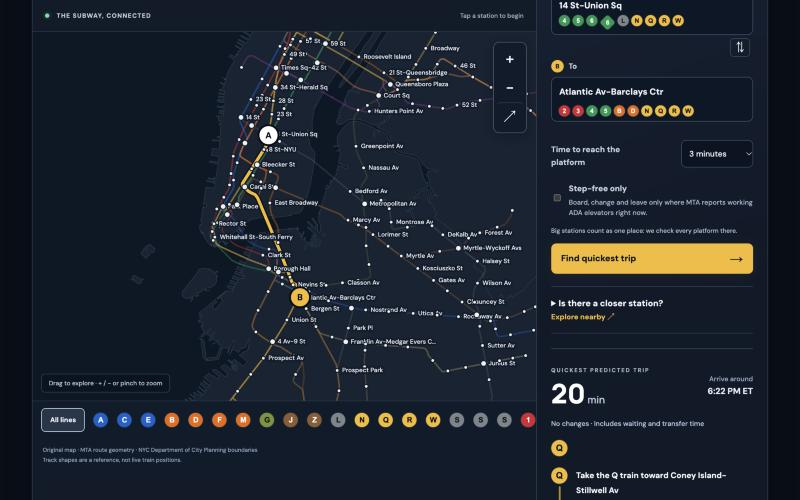
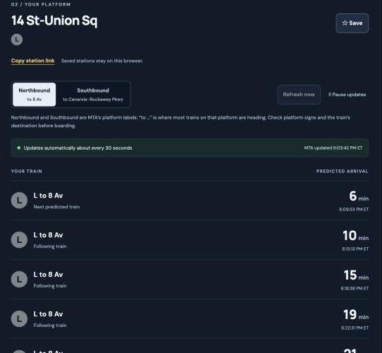
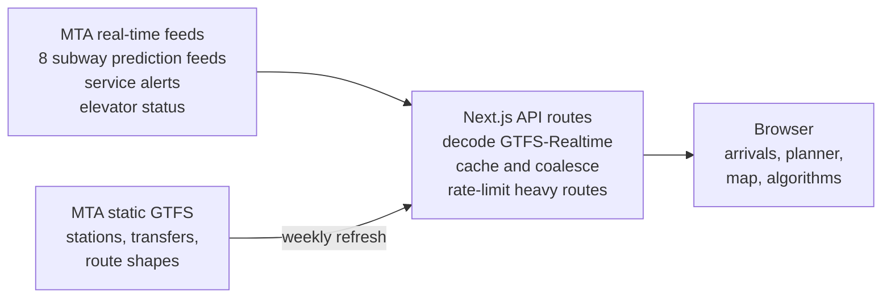
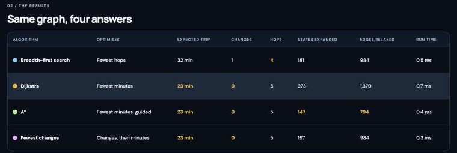

# StreetCode NYC

**A live companion for the New York City subway.** StreetCode NYC brings real-time arrivals, trip planning, step-free routing, elevator status and service alerts for every station together on one page, and shows how classic graph algorithms behave on the live subway network.

[](https://github.com/AMV9978/streetcode-nyc/actions/workflows/ci.yml)

**Live site:** [streetcodenyc.angelovasquez.net](https://streetcodenyc.angelovasquez.net) · **Algorithms page:** [/algorithms](https://streetcodenyc.angelovasquez.net/algorithms)

Team Project 13 for the NYU LeetCode BootCamp.



## Contents

- [Why we built it](#why-we-built-it)
- [Features](#features)
- [How it works](#how-it-works)
- [Algorithms](#algorithms)
- [Getting started](#getting-started)
- [Testing](#testing)
- [API reference](#api-reference)
- [Project structure](#project-structure)
- [Deployment](#deployment)
- [Data sources and limitations](#data-sources-and-limitations)
- [Team](#team)

## Why we built it

A rider standing at 14 St–Union Sq usually wants answers to four questions at once:

1. Which platform, and when is the next train?
2. What is the fastest way to where I am going?
3. Are the elevators working right now?
4. Is a service change affecting my trip?

StreetCode NYC answers all four in one visit, and always shows how fresh each answer is.

## Features

| Feature | What it does |
| --- | --- |
| **Live arrivals** | Countdowns for every station, refreshed about every 30 seconds. Trains are labelled by destination ("L to 8 Av"), not only by direction. |
| **Trip planner** | Finds the earliest predicted arrival in the next hour from the trains running right now, using the RAPTOR algorithm. It offers trade-offs such as "33 min, 1 change" or "44 min, no changes", and shows the service alerts that affect the trip. |
| **Step-free trips** | Plans only through stations where MTA reports working ADA elevators. |
| **Elevator status** | Lists working elevators and planned outages at each station. |
| **Service updates** | Shows active and planned MTA alerts for a station and its lines. |
| **Interactive subway map** | Lets you tap a station, filter by line, and drag or zoom. Track shapes come from MTA route geometry. |
| **Algorithms on the live subway** | Races BFS, Dijkstra, A* and a fewest-changes search on a graph built from current train predictions, and animates each one exploring the map. |
| **Countdown accuracy** | Scores what each countdown said 1, 3, 5, 10 and 20 minutes ahead against when the train actually arrived. |
| **Clear "no trip" answers** | Explains why no trip was found: the trip needs the Staten Island Ferry, no trains are leaving that station, or the trip is longer than the one-hour live window. In the last case it gives a typical travel time instead. |

Riders can also save stations, share a link to a station, and find nearby stations by location. No account is needed; saved stations stay in the browser.

<p align="center">
  
</p>

## How it works



- **Feeds.** The server reads MTA's GTFS-Realtime feeds for train predictions, alerts and elevator outages. No MTA API key is needed.
- **Caching.** Train data is cached for 25 seconds and concurrent requests share one upstream call. The live graph and elevator outages are cached for 60 seconds, and the elevator list for 6 hours. If MTA stops responding, the last good train data is served for up to 5 minutes, clearly marked as stale.
- **Refresh.** The browser asks again about 30 seconds after each update completes, pauses while the tab is hidden, and backs off after errors.
- **Static data.** A weekly GitHub Actions workflow downloads MTA's static GTFS, rebuilds the station catalog, transfers and map, runs the tests, and opens a pull request if anything changed.

## Algorithms

The [/algorithms](https://streetcodenyc.angelovasquez.net/algorithms) page builds a weighted graph of the whole subway from the trains MTA is predicting at that moment. Each edge uses the median ride time for that segment plus an expected wait of half the current gap between trains. Pick two stations and four algorithms run on the same graph.

| Algorithm | Optimizes | Time complexity |
| --- | --- | --- |
| Breadth-first search | Fewest hops | O(V + E) |
| Dijkstra (binary min-heap) | Fewest minutes | O((V + E) log V) |
| A* (admissible straight-line heuristic) | Fewest minutes, exploring fewer states | O((V + E) log V) worst case |
| Fewest changes (lexicographic Dijkstra) | Train changes first, then minutes | O((V + E) log V) |



**Why the search state is (station, line).** Staying on a train is free, but switching lines costs a transfer and a wait. A search that remembered only the station would merge those two situations and could return a route that is not actually the fastest.

**The trip planner uses RAPTOR.** Instead of average times, RAPTOR works on individual trains in rounds: round *k* finds the earliest arrival using at most *k* trains. The result is a set of trade-offs between speed and the number of changes. It is property-tested against an independent earliest-arrival search on 3,000 random networks.

## Getting started

**Requirements:** Node.js 22.13 or later (22.x or 24.x).

```sh
git clone https://github.com/AMV9978/streetcode-nyc.git
cd streetcode-nyc
npm ci
npm run dev        # development server at http://localhost:3000
```

For a production build:

```sh
npm run build      # production build and TypeScript check
npm start          # serves http://localhost:3000
```

| Variable | Required | Purpose |
| --- | --- | --- |
| `MTA_FEED_BASE` | No | Points the server at a different MTA-compatible base URL, for example to replay a recorded snapshot in tests. Leave it unset in production. |

## Testing

```sh
npm test               # 53 unit and property tests
npm run test:smoke     # checks the local HTTP server
npm run test:live      # also checks every live MTA feed
```

The tests cover feed decoding, caching and stale fallback, routing, RAPTOR, the live graph, countdown accuracy, elevator data and the rate limiter.

Every push runs the CI workflow, which installs dependencies, runs the tests, builds the app, runs the smoke test, and fails on any high or critical `npm audit` finding.

## API reference

All endpoints return JSON with `Cache-Control: no-store`.

| Endpoint | Purpose |
| --- | --- |
| `GET /api/arrivals?feed=l[&stop=L03][&format=protobuf]` | Decoded feed. With `stop`, only that station's predictions. With `format=protobuf`, the raw bytes. |
| `GET /api/alerts?format=json[&routes=L,4]` | Subway alerts, optionally filtered to specific lines |
| `GET /api/journey?from=&to=&readyIn=3[&scope=complex][&stepFree=1]` | Trip options, search statistics, reason codes, a typical-time estimate and relevant alerts |
| `GET /api/graph` | Live whole-network graph |
| `GET /api/elevators?station=L03` | Elevators and outages at a station complex |
| `GET /api/reliability[?route=L]` | Countdown accuracy summary |

`/api/journey` is limited to 30 requests a minute per client (burst of 15), and `/api/graph` to 20 (burst of 10). Over the limit, the server answers `429` with a `Retry-After` header.

## Project structure

```text
app/
  page.tsx                  Home page: arrivals, alerts, elevator status, accuracy
  algorithms/page.tsx       Algorithms on the live subway
  components/               JourneyPlanner, AlgorithmLab, LineBadge
  api/                      arrivals, alerts, journey, graph, elevators, reliability
lib/
  transit/
    raptor.js               RAPTOR trip search
    journey.js              Independent search used as a test oracle
    graph.js                Live graph builder: BFS, Dijkstra, A*, fewest changes
    heap.js                 Binary min-heap
    feed.js                 GTFS-Realtime decoder and feed allowlist
    service.js              Upstream fetch, shared cache, stale fallback
    elevators.js            MTA elevator data to step-free stations
    reliability.js          Countdown accuracy tracker
    routes.js               Line normalization (6X to 6) and alert relevance
  http/limit.js             Token-bucket rate limiter
scripts/build-map-data.py   Rebuilds the station catalog, transfers and map from MTA GTFS
public/lab/                 The original 17-station teaching simulation
tests/                      Unit and property tests
.github/workflows/          CI and the weekly map-data refresh
docs/                       Audit, validation records and deployment guide
```

## Deployment

The site runs as a Node.js app on Hostinger using the Next.js preset.

| Setting | Value |
| --- | --- |
| Node.js | 22.x or 24.x |
| Root directory | `./` |
| Install | `npm ci` |
| Build | `npm run build` |
| Start | `npm start` |
| Output | `.next` |

With auto-deploy on, pushing to `main` redeploys the site. Step-by-step instructions are in [docs/UPLOAD_GUIDE.md](docs/UPLOAD_GUIDE.md).

## Data sources and limitations

**Sources**

- [MTA real-time feeds](https://api.mta.info/) and [MTA developer resources](https://www.mta.info/developers)
- [MTA static subway GTFS](https://rrgtfsfeeds.s3.amazonaws.com/gtfs_subway.zip)
- [GTFS-Realtime reference](https://gtfs.org/documentation/realtime/reference/)

**Limitations**

- Arrival times are predictions, not guarantees. No prediction does not mean no service.
- The planner covers the subway and Staten Island Railway only. It does not include buses, ferries or walking routes.
- Step-free mode is an approximation. It counts a station when MTA lists an ADA elevator there and none of its non-redundant ADA elevators is out. It does not know which entrance or direction each elevator serves, and does not include stations that are accessible by ramp only.
- Service alerts are shown, but are not turned into closed tracks in the planner.
- Accuracy scores and caches are kept in memory. They reset when the server restarts and are not shared between server instances.

The full code audit is in [docs/AUDIT-2026-11.md](docs/AUDIT-2026-11.md), and the release history is in [CHANGELOG.md](CHANGELOG.md).

## Team

| Name |
| --- |
| Mannah Mohamed |
| Angelo Vasquez |
| Rea Ara |
| Colin Stephenson |
| Zhining Yu |

---

StreetCode NYC is an independent student project. It is not affiliated with or endorsed by the Metropolitan Transportation Authority. For official service information, visit [mta.info](https://www.mta.info).
